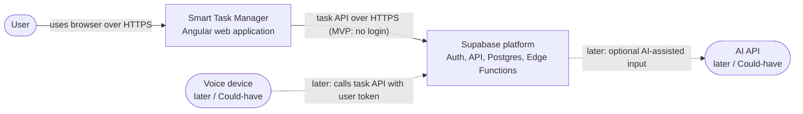
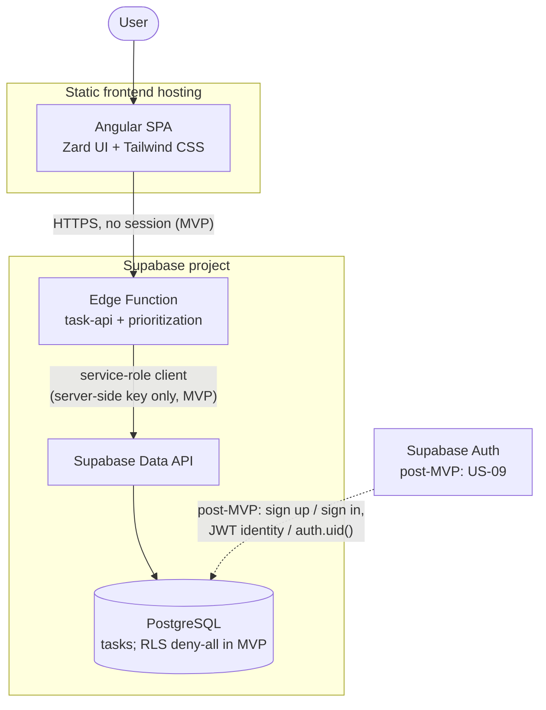
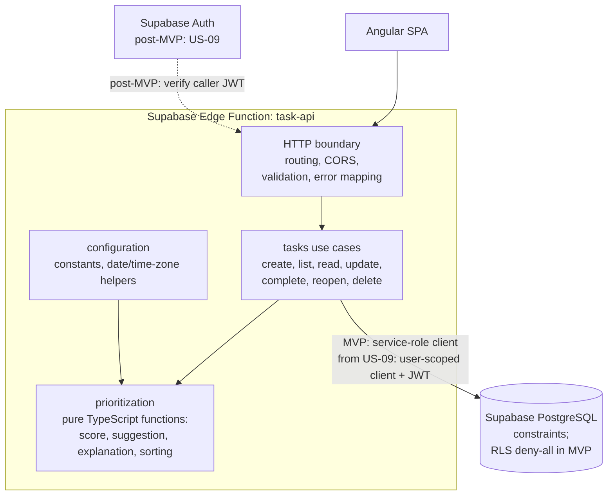
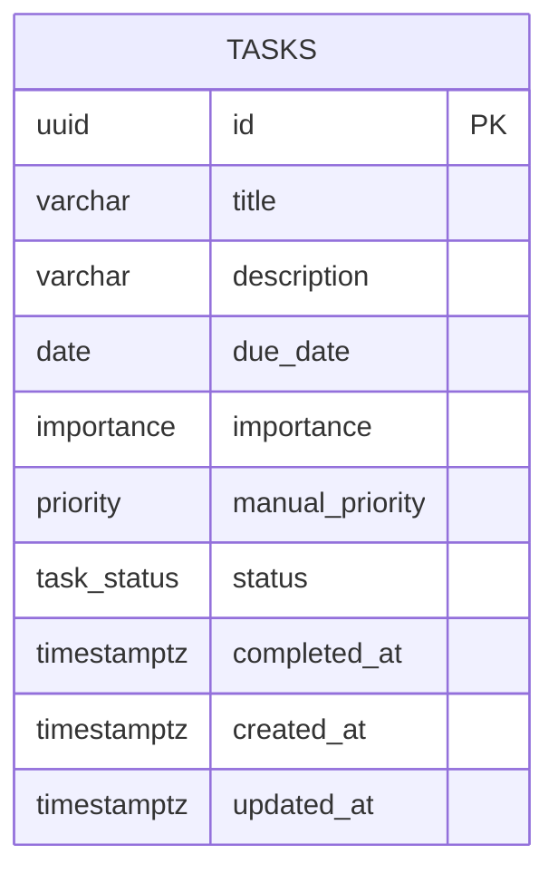

# Architecture – Smart Task Manager

Phase 2 deliverable. This document describes the architecture variants, chosen technology stack, diagrams, data model and API design.

---

## 1. Architecture drivers

| Driver                                                                                              | Source                | Architectural consequence                                                                               |
| --------------------------------------------------------------------------------------------------- | --------------------- | ------------------------------------------------------------------------------------------------------- |
| Backend owns all prioritization logic; frontend contains none                                       | FR-12                 | Angular calls server-side Supabase Edge Function; no priority calculation in components/services        |
| Urgency depends on user's local date and changes without action                                     | FR-04, AC-02.4        | Compute priority on reads; client sends IANA time zone                                                  |
| Prioritization is deterministic and testable (≥90% branch coverage, injectable date)                | NFR-04, NFR-05        | Pure TypeScript module in Edge Function code; constants centralized                                     |
| 500 tasks: list API ≤500 ms (p95)                                                                   | NFR-01                | Indexed Postgres filtering then in-memory scoring; benchmark Edge Function path                         |
| Only Must-have stories ship in the MVP; accounts (US-09) are a Should-have and follow after the MVP | mvp.md, FR-15, NFR-08 | MVP: no authentication, single-user; from US-09 on: Supabase Auth + PostgreSQL Row Level Security (RLS) |
| No task data sent to third-party services; no paid external services                                | NFR-07, NFR-10        | Hosted Supabase requires an explicit interpretation of NFR-07; verify free-tier limits and costs        |
| Later voice device and AI input use API                                                             | FR-18, FR-19          | Stable Edge Function API and token-based Auth                                                           |
| Small team, one semester, explainable                                                               | Phase 2 assignment    | Angular SPA + managed Supabase backend; avoid custom server and microservices                           |

---

## 2. Architecture variants

Three architectural approaches are compared. Variants A and B are evaluated in depth. Variant C is included as a deliberately more distributed alternative.

### Variant A – Angular SPA + Supabase managed backend

An Angular single-page application communicates with Supabase through its Auth/Data API and a task-oriented Edge Function. Supabase provides managed PostgreSQL, authentication and row-level security (RLS). The Edge Function owns task use cases that require server-side business logic, especially prioritization.

### Variant B – Angular SPA + custom modular monolith API + PostgreSQL

An Angular single-page application communicates with one custom backend application over a REST/JSON API. The backend is a modular monolith (for example Node.js/Express or NestJS) with internal modules for authentication, tasks and prioritization. It connects to a PostgreSQL database that the team or hosting provider operates.

### Variant C – Microservices / serverless functions

Task management, authentication and prioritization are split into independently deployed services or functions behind an API gateway. Each service has its own deployment and operational concerns.

### Comparison

| Criterion                                                   | A: Angular SPA + Supabase                                                                             | B: Angular SPA + modular monolith                                                 | C: Microservices / serverless                                                |
| ----------------------------------------------------------- | ----------------------------------------------------------------------------------------------------- | --------------------------------------------------------------------------------- | ---------------------------------------------------------------------------- |
| Fits FR-12 (separate frontend, logic only in backend API)   | ✅ Edge Function provides the server-side task API; keep prioritization out of Angular                | ✅ Direct fit through the custom REST API                                         | ✅                                                                           |
| Fits later clients (voice device, AI input, FR-18/19)       | ✅ Edge Function API and token-based Auth can be reused                                               | ✅ The API exists from day one                                                    | ✅                                                                           |
| Instant list updates without page reload (AC-03.2, AC-01.1) | ✅ Natural in an Angular SPA                                                                          | ✅ Natural in an Angular SPA                                                      | ✅                                                                           |
| Complexity and effort for a semester project                | ✅ Low–medium custom backend effort; platform configuration and RLS still require care                | ⚠️ Medium: API, auth, database and deployment must be implemented/operated        | ❌ High: several deployments, networking, distributed data and observability |
| Testability of the prioritization logic (NFR-04)            | ✅ Pure TypeScript module inside Edge Function code                                                   | ✅ Pure module in the backend                                                     | ⚠️ Possible, but more integration overhead                                   |
| Hosting cost (NFR-10)                                       | ⚠️ Can fit free tiers, but quotas and paid usage must be checked; hosted Supabase processes task data | ⚠️ Low-cost/free options exist, but database and API hosting must both be checked | ❌ Several services or usage-based cloud resources increase cost risk        |
| Fit for the project size                                    | ✅                                                                                                    | ✅                                                                                | ❌ Overengineering for the MVP scope                                         |

**Trade-offs in short**

- A reduces the amount of custom backend infrastructure: authentication, PostgreSQL hosting and row-level access control are provided by Supabase. The trade-off is platform dependency and the need to understand and test RLS, Auth configuration, Edge Functions and provider limits.
- B gives the team more control over backend behavior and hosting. It also means the team must implement and maintain authentication, authorization, API deployment and database operations itself. It is a valid alternative if the privacy or offline constraints rule out hosted Supabase.
- C addresses independent scaling and deployment needs that the current MVP does not have. It adds operational complexity without a matching requirement.

**Decision: Variant A, conditionally.** It is the lowest-custom-infrastructure option and meets the required server-side API separation. However, it is only compatible with Phase 1 NFR-07 if the project explicitly accepts Supabase as an infrastructure processor. If NFR-07 is interpreted as prohibiting any third-party processing of task data, Variant A is not compliant and Variant B must be selected with self-hosted/local PostgreSQL or another approved deployment. This is a product/privacy decision for the student group, not something the architecture can silently assume. See [ADR-0001](0001-modular-monolith-with-separate-spa.md).

## 3. Technology decisions

| Area                       | Choice                                                                                                          | Rationale                                                                                                                                                                  | Alternatives considered                                 |
| -------------------------- | --------------------------------------------------------------------------------------------------------------- | -------------------------------------------------------------------------------------------------------------------------------------------------------------------------- | ------------------------------------------------------- |
| Language                   | **TypeScript**                                                                                                  | Angular and Edge Functions can share language and domain types                                                                                                             | Java, Python, C#                                        |
| Frontend framework         | **Angular** (standalone components, Angular Router)                                                             | Requested stack; structured framework and TypeScript                                                                                                                       | React, Vue                                              |
| UI library                 | **Zard UI** (`zard/ui`)                                                                                         | Angular-native component library; official docs describe Tailwind CSS v4 support. Pin a Zard UI release whose Angular peer dependencies match the selected Angular version | Angular Material, custom components                     |
| CSS/styling                | **Tailwind CSS v4**, configured by Zard UI CLI                                                                  | Required by Zard UI setup; utility styling                                                                                                                                 | SCSS-only                                               |
| Backend platform           | **Supabase**                                                                                                    | Managed Postgres, Auth, Data API and Edge Functions                                                                                                                        | Custom Express backend                                  |
| Server-side business logic | **Supabase Edge Functions** (Deno runtime, TypeScript)                                                          | Executes task operations and prioritization outside browser                                                                                                                | Client-side logic (rejected by FR-12), SQL-only scoring |
| Database                   | **Supabase PostgreSQL**                                                                                         | Relational model, constraints, indexes, `ILIKE`; see ADR-0002                                                                                                              | SQLite, MongoDB                                         |
| Authentication             | **Supabase Auth**                                                                                               | Managed registration/login/session lifecycle; JWT integrated with RLS. Post-MVP (US-09): the MVP itself has no authentication (single-user)                                | Custom sessions, hand-built JWT                         |
| Data access                | `@supabase/supabase-js` in Angular and Edge Functions; SQL migrations via Supabase CLI                          | Official client and versioned schema; no ORM needed for MVP                                                                                                                | Prisma, handwritten REST client                         |
| Validation                 | Shared TypeScript validation at Edge Function boundary (e.g. Zod) plus database constraints                     | Friendly API errors plus persistence-level safety net                                                                                                                      | Frontend-only validation (insufficient)                 |
| Testing                    | **Vitest** for pure prioritization/validation; integration tests against local Supabase; **Playwright** for E2E | Covers domain rules, RLS and user journeys                                                                                                                                 | Jest, Cypress                                           |
| UI testing/accessibility   | Playwright + manual keyboard/screen-reader checks                                                               | Zard UI components still need integration-level accessibility checks                                                                                                       | –                                                       |
| Local development          | **Supabase CLI** local stack + Angular CLI dev server                                                           | Reproducible local Auth/Postgres/Functions                                                                                                                                 | Hosted project only                                     |
| CI                         | **GitHub Actions** (lint, unit/integration tests, Angular build; deployment only after explicit configuration)  | Repository already on GitHub                                                                                                                                               | –                                                       |
| Hosting                    | Static Angular hosting + Supabase project                                                                       | Separate deployables; see hosting.md                                                                                                                                       | One combined Docker image                               |

---

## 4. Architecture diagrams

### 4.1 Level 1 – System context



Solid arrows are MVP interactions. Dashed arrows are possible future extensions, not MVP functionality. In the MVP there is no login; accounts (US-09, Should) follow after the MVP, as do the voice device and AI API.

### 4.2 Level 2 – Containers



In the MVP there is no authentication (US-09 is a Should-have and follows after the MVP). The browser receives a Supabase publishable key, which identifies the project but is not a secret. RLS stays enabled with deny-all policies, so the Data API alone cannot serve task rows; the Edge Function accesses the database server-side with the service-role key, which must never be included in Angular. From US-09 on, Angular signs in through Supabase Auth, requests carry the user's JWT, and user-scoped RLS policies enforce that each user sees only their own tasks.

### 4.3 Level 3 – Backend components



In the single-user MVP, the Edge Function uses the server-side service-role key (there is no authentication to forward) while RLS remains deny-all for all other callers. From US-09 on, the Edge Function must use the caller's JWT for ordinary task access so RLS is applied, and it must not silently switch to a service-role client. The prioritization module has no database, network or clock access; it receives `today` as an argument.

---

## 5. Backend structure and responsibilities

The backend is implemented as one Edge Function (`task-api`) with internal modules. Supabase Auth (post-MVP, US-09) and Postgres are managed platform services; in the MVP only Postgres is used.

| Area                     | Responsibility                                                                                                                                 | Requirements                          |
| ------------------------ | ---------------------------------------------------------------------------------------------------------------------------------------------- | ------------------------------------- |
| Edge Function HTTP layer | Route requests, validate input, resolve local date from `X-Time-Zone`, map errors; from US-09 on: derive the authenticated user                | FR-12, NFR-03, NFR-08                 |
| `tasks`                  | Task use cases; persistence calls; status/search filtering; effective-priority filtering and sorting                                           | FR-01–FR-02, FR-06–FR-11, FR-13–FR-14 |
| `prioritization`         | Score, suggested priority, explanation, comparator; pure module without I/O                                                                    | FR-03–FR-05, NFR-04, NFR-05           |
| `persistence`            | Supabase client calls and typed database model; in the MVP with the server-side service-role key, from US-09 on with the caller's JWT retained | FR-02, NFR-08                         |
| Supabase Auth            | Registration, login, logout, token refresh and user identity (post-MVP, US-09; not used in the MVP)                                            | FR-15 (Should), NFR-08                |
| PostgreSQL/RLS           | Schema, constraints, indexes and row authorization (deny-all in the MVP; per-user from US-09 on)                                               | FR-02, NFR-03, NFR-08                 |
| `config`                 | Score constants, field limits, date/time-zone helpers                                                                                          | NFR-05                                |

Proposed repository layout (adapt paths to the actual repository structure):

```text
/frontend
  /src
    /app
      /core             Supabase client, auth state and guards (only from US-09 on)
      /features/tasks   task pages, components, task data service
      /shared           shared UI and types
    /environments
  angular.json
/supabase
  /functions/task-api  Edge Function entry point and routes
  /migrations          versioned SQL schema, indexes and RLS policies
  config.toml
/docs
  architecture.md
  hosting.md
  /adr
```

Keep domain types and validation rules in a small shared TypeScript package only if the build setup can share it cleanly. Do not duplicate the priority algorithm in Angular.

---

## 6. Prioritization design

The rules are defined in [requirements.md, section 2](../requirements.md). This section describes where they live and how they are called.

```ts
// prioritization/score.ts – pure TypeScript, no database, no clock
export type Importance = "LOW" | "MEDIUM" | "HIGH";
export type Priority = "LOW" | "MEDIUM" | "HIGH";

export interface PriorityInput {
    importance: Importance;
    dueDate: string | null; // 'YYYY-MM-DD' (calendar date)

    manualPriority: Priority | null;
}

export interface PriorityResult {
    score: number; // 0..80
    suggested: Priority;
    manual: Priority | null;
    effective: Priority; // manual ?? suggested
    isManual: boolean;
    explanation: string;
}

export function evaluate(input: PriorityInput, today: string): PriorityResult;
export function compareForList(a: ScoredTask, b: ScoredTask): number;
```

Key design points:

- `today` is a parameter. The Edge Function resolves it once per request from the `X-Time-Zone` IANA time-zone header. Tests pass fixed dates.
- Constants live in one file (`config/prioritization.ts`): urgency points, importance points and thresholds 55 and 30 (NFR-05).
- Calendar days, not hours, are used after resolving `today`.
- Explanation text is built from the same values as the score (`overdue`, `due today`, `due tomorrow`, `due in N days`, `no due date`).

### Priority is computed when read, not stored

Do not store score, suggested priority or explanation. Store only user inputs (`importance`, `due_date`, `manual_priority`). The Edge Function calculates priority whenever it returns tasks. This satisfies AC-02.4 without a scheduled job. See [ADR-0003](0003-compute-priority-at-read-time.md).

The function first retrieves rows and filters by status/title. In the MVP this uses the server-side service-role key (no authentication); from US-09 on it uses a caller-scoped client with RLS. It then scores, filters by effective priority and sorts according to requirements.md section 2.4. Priority filtering and sorting therefore happen in application code, not through a database index. Benchmark 500-task lists against NFR-01.

---

## 7. Data model



### Tables

`auth.users` **(managed by Supabase Auth; introduced with US-09, post-MVP)**

In the MVP there are no accounts, so `tasks` has no `user_id`. From US-09 on, Supabase owns this table and its lifecycle; the application must not create or modify password hashes or session rows, and `tasks.user_id` references `auth.users.id` with `ON DELETE CASCADE`.

`public.tasks`

| Column            | Type                       | Constraints                                                                          |
| ----------------- | -------------------------- | ------------------------------------------------------------------------------------ |
| `id`              | uuid                       | primary key, default `gen_random_uuid()`                                             |
| `user_id`         | uuid                       | added with US-09 (post-MVP): not null, references `auth.users(id)` on delete cascade |
| `title`           | varchar(200)               | not null; trimmed length ≥ 1                                                         |
| `description`     | varchar(2000)              | nullable                                                                             |
| `due_date`        | date                       | nullable; calendar date without time                                                 |
| `importance`      | enum `LOW`/`MEDIUM`/`HIGH` | not null, default `MEDIUM`                                                           |
| `manual_priority` | enum `LOW`/`MEDIUM`/`HIGH` | nullable; null means use suggestion                                                  |
| `status`          | enum `OPEN`/`DONE`         | not null, default `OPEN`                                                             |
| `completed_at`    | timestamptz                | set iff `status = 'DONE'` (check constraint)                                         |
| `created_at`      | timestamptz                | not null, default now                                                                |
| `updated_at`      | timestamptz                | not null; maintained on update                                                       |

Index: `(user_id, status)` for the common user/status list query. Add a suitable title-search index only if measurement shows it is needed; ordinary `ILIKE '%term%'` may require a trigram index for larger datasets.

**RLS policy requirements**

- MVP (no accounts, US-09 is a Should-have): keep RLS enabled with no permissive policies (deny by default) and no grants to `anon`/`authenticated`, so the public Data API cannot read or write task rows; the Edge Function uses the server-side service-role key.
- From US-09 on: add user-scoping policies on `public.tasks`.
    - `SELECT`, `INSERT`, `UPDATE` and `DELETE` policies apply to `authenticated` only.
    - For reads/updates/deletes, require `(select auth.uid()) = user_id`.
    - For inserts, require `WITH CHECK ((select auth.uid()) = user_id)`.
    - For updates, enforce both `USING` and `WITH CHECK` so a user cannot transfer a row to another user.
- Review table grants as well as policies. RLS does not replace SQL privileges.
- From US-09 on, add automated tests proving user B cannot read, change or delete user A's tasks.

Design notes:

- Priority score, suggestion and explanation are intentionally not stored.
- Deleting a task is a real delete (AC-07.2).
- Past due dates are allowed.
- Enforce title/description limits both in Edge Function validation and database constraints.

---

## 8. API design

### 8.1 Conventions

- From US-09 on, Supabase Auth endpoints are accessed through `supabase.auth` in the Angular client (the MVP has no authentication).

- Task operations use the Edge Function base URL `/functions/v1/task-api`; requests and responses use JSON.

- In the MVP, task operations require no authentication; the Edge Function runs server-side with the service-role key. From US-09 on, all task operations require a valid Supabase user JWT: the function must verify the caller and use a caller-scoped database client so RLS remains effective.

- Every request returning tasks carries `X-Time-Zone: <IANA name>`, e.g. `Europe/Vienna`. If missing, use `UTC`; reject an unknown value with `400`.
- Dates are `YYYY-MM-DD`; timestamps are ISO 8601 UTC.

- A task belonging to another user returns `404`, not `403`, so existence is not revealed (from US-09 on; in the MVP there is no other user).

- Unknown fields in request bodies are rejected.

### 8.2 Authentication operations (post-MVP, US-09)

| Operation    | Supabase client method                          | Purpose                        |
| ------------ | ----------------------------------------------- | ------------------------------ |
| Register     | `supabase.auth.signUp()`                        | Create account                 |
| Login        | `supabase.auth.signInWithPassword()`            | Authenticate                   |
| Logout       | `supabase.auth.signOut()`                       | End local session              |
| Current user | `supabase.auth.getUser()` / auth state listener | Restore and observe user state |

(Post-MVP, US-09.) Account lifecycle behavior (including email confirmation and redirect URLs) is configured in Supabase Auth, not implemented as custom `/auth/*` endpoints.

### 8.3 Task API operations

The following routes are handled by the `task-api` Edge Function. The function may dispatch by HTTP method and path.

| Method and path             | Purpose                                                                                                            | Success | Stories / requirements            |
| --------------------------- | ------------------------------------------------------------------------------------------------------------------ | ------- | --------------------------------- |
| `GET /tasks`                | List tasks and compute priority on the fly (from US-09 on: the current user's tasks; in the MVP the single user's) | `200`   | US-03, US-08, FR-06, FR-14        |
| `POST /tasks`               | Create a task                                                                                                      | `201`   | US-01, FR-01                      |
| `GET /tasks/{id}`           | Read one task                                                                                                      | `200`   | US-01, US-02                      |
| `PATCH /tasks/{id}`         | Update title, description, dueDate, importance, manualPriority                                                     | `200`   | US-04, US-06, FR-07, FR-08, FR-11 |
| `POST /tasks/{id}/complete` | Mark done; idempotent                                                                                              | `200`   | US-05, FR-10                      |
| `POST /tasks/{id}/reopen`   | Reopen; idempotent                                                                                                 | `200`   | US-05, FR-10                      |
| `DELETE /tasks/{id}`        | Permanently delete                                                                                                 | `204`   | US-07, FR-13                      |

**Query parameters of `GET /tasks`** (combined with AND, FR-14, AC-08.4):

| Parameter  | Values                  | Default   | Meaning                                                                |
| ---------- | ----------------------- | --------- | ---------------------------------------------------------------------- |
| `status`   | `open`, `done`, `all`   | `open`    | Status filter; `done` is sorted by `completed_at` descending (AC-08.2) |
| `priority` | `LOW`, `MEDIUM`, `HIGH` | no filter | Filters by effective priority (AC-08.1)                                |
| `q`        | free text               | no filter | Case-insensitive substring match on the title (AC-08.3)                |

Sorting follows requirements.md section 2.4 for open tasks and `completed_at` descending for done tasks (AC-08.2). The MVP list is not paginated; NFR-01 assumes up to 500 tasks.

### 8.4 Task representation

```json
{
    "id": "7b0c2e0e-5e0e-4a52-9d6c-3f1c9f0a1b11",
    "title": "Submit course assignment",
    "description": null,
    "dueDate": "2026-11-23",
    "importance": "HIGH",
    "status": "OPEN",
    "completedAt": null,
    "createdAt": "2026-11-22T12:00:00Z",
    "updatedAt": "2026-11-22T12:00:00Z",
    "priority": {
        "score": 70,
        "suggested": "HIGH",
        "manual": null,
        "effective": "HIGH",
        "isManual": false,
        "explanation": "High – due tomorrow, importance high"
    }
}
```

`GET /tasks` returns `{ "items": [ ...tasks ] }`.

Create request:

```json
{
    "title": "Buy birthday present",
    "dueDate": "2026-11-27",
    "importance": "MEDIUM"
}
```

Override and reset:

```json
{ "manualPriority": "HIGH" }
{ "manualPriority": null }
```

From US-09 on, the `user_id` is derived from the verified JWT and must never be trusted from the request body. In the MVP there is no `user_id`.

### 8.5 Errors

Use one error format for function-generated failures:

```json
{
    "error": {
        "code": "VALIDATION_ERROR",
        "message": "Title is required.",
        "details": [{ "field": "title", "message": "Title must not be empty." }]
    }
}
```

| Status | When                                                                                   |
| ------ | -------------------------------------------------------------------------------------- |
| `400`  | Invalid input, enum, date or time zone; nothing is stored                              |
| `401`  | Missing, invalid or expired user session (from US-09 on; no authentication in the MVP) |
| `404`  | Task does not exist or belongs to another user                                         |
| `409`  | Conflict such as duplicate account (Auth may return its own error shape)               |
| `429`  | Rate limit exceeded                                                                    |

Supabase Auth errors (from US-09 on) may have a platform-specific response shape; Angular should normalize them for display without exposing sensitive details.

---

## 9. Cross-cutting concerns

**Security (NFR-08)**

- The MVP has no authentication (single-user). From US-09 on, Supabase Auth handles password storage, token issuance and refresh; do not implement a parallel password/session store.
- Keep RLS enabled on every exposed application table. In the MVP, use deny-all policies with no grants to `anon`/`authenticated`; from US-09 on, add per-user policies and verify grants plus policies.

- Never ship a Supabase secret/service-role key in Angular, source control or public build artifacts. Browser code uses only the publishable key.

- In the MVP, Edge Function task requests run without authentication and use the server-side service-role client. From US-09 on, task requests require a verified user identity and use a user-scoped client/JWT for ordinary data access; elevated access requires a separate, justified server-only use case.

- Validate all inputs at the Edge Function boundary and enforce critical invariants with database constraints.

- From US-09 on, configure Auth redirect URLs, password policy, email confirmation and rate limits. Configure restrictive CORS for the Angular origin (also in the MVP).
- From US-09 on, test cross-user isolation, unauthenticated access and attempts to alter `user_id`; in the MVP, test that unauthenticated callers cannot reach task rows through the Data API.

**Performance (NFR-01)**

Use indexed Postgres filters for user and status, then in-memory scoring of up to 500 rows. Benchmark the full Angular → Edge Function → Postgres path, including cold starts. Add pagination or optimize search if p95 exceeds 500 ms.

**Reliability (NFR-03)**

Postgres persists data independently of Angular and Edge Function deployments. Use migrations for schema changes. Include meaningful loading, error and retry states in Angular; do not treat a successful UI action as persisted until the request succeeds.

**Privacy (NFR-07)**

No AI or other unrelated third-party API receives task data in the MVP. Supabase and the static host are infrastructure providers processing application data; confirm their region, retention, terms and suitability against the project's privacy requirements.

**Testing strategy**

| Level            | Scope                                                                                                                                          | Tool                              |
| ---------------- | ---------------------------------------------------------------------------------------------------------------------------------------------- | --------------------------------- |
| Unit             | Prioritization E1–E12, boundaries 29/30 and 54/55, urgency ranges, sorting, validation                                                         | Vitest                            |
| Integration      | Edge Function routes, database constraints, RLS (deny-all in the MVP) against local Supabase; from US-09 on also Auth and cross-user isolation | Vitest + Supabase CLI/local stack |
| End to end       | Full demo journey including the task lifecycle; from US-09 on including register/login                                                         | Playwright                        |
| UI/accessibility | Keyboard navigation, focus, labels, dialogs, responsive layout                                                                                 | Playwright + manual review        |

---

## 10. Extensibility

None of these features are part of the MVP.

| Story                                                      | Future implementation                                                                                                               |
| ---------------------------------------------------------- | ----------------------------------------------------------------------------------------------------------------------------------- |
| US-09 accounts (FR-15, Should)                             | Enable Supabase Auth, add `user_id` and RLS policies, add register/login UI; see [ADR-0004](0004-session-cookie-authentication.md)  |
| US-10 hint when suggestion exceeds manual priority (FR-16) | Add comparison to the pure prioritization module and response object                                                                |
| US-11 effort estimate (FR-17)                              | Add nullable task column and scoring rule; update migration and tests                                                               |
| US-12 AI-assisted input (FR-18)                            | Add a server-side Edge Function integration; keep provider secrets server-side and obtain explicit consent before sending task text |
| US-13 voice device (FR-19)                                 | Device calls the existing task API with a supported user token; review device authentication and refresh lifecycle                  |
| US-14 reminders (FR-20)                                    | In-app due-today query; scheduled email/push needs a separate scheduler and privacy decision                                        |

---

## 13. Traceability

| Architectural decision                | Requirements / source                                  |
| ------------------------------------- | ------------------------------------------------------ |
| Angular SPA + Supabase backend        | FR-12, FR-18, FR-19, NFR-10                            |
| Edge Function owns prioritization     | FR-03–FR-05, FR-12, NFR-04, NFR-05                     |
| Supabase Auth + RLS (post-MVP, US-09) | FR-15 (Should), NFR-08; the MVP relies on deny-all RLS |
| PostgreSQL constraints and indexes    | FR-02, FR-14, NFR-01, NFR-03                           |
| Separate static frontend deployment   | NFR-08, NFR-10                                         |
| Local date via `X-Time-Zone`          | FR-04, AC-02.4                                         |
| No external AI integration in MVP     | NFR-07, NFR-10                                         |
